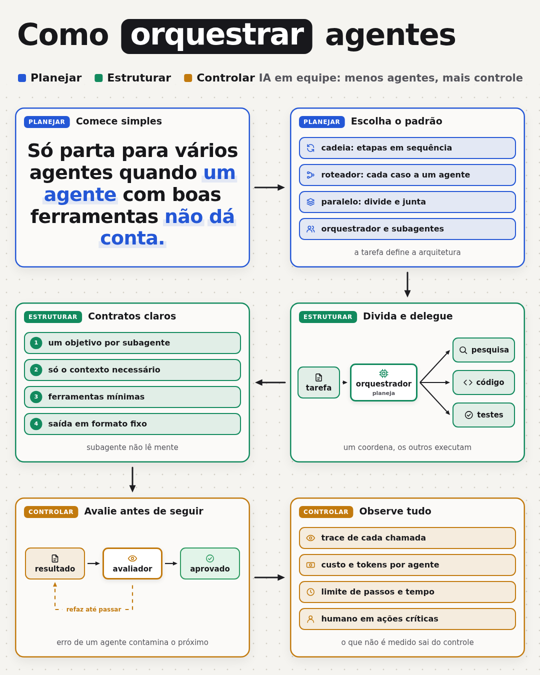
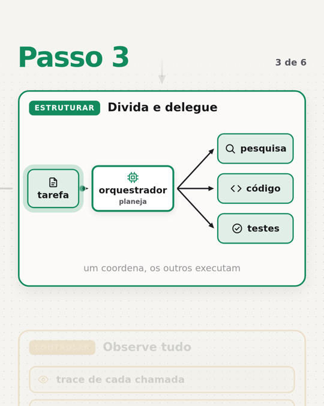
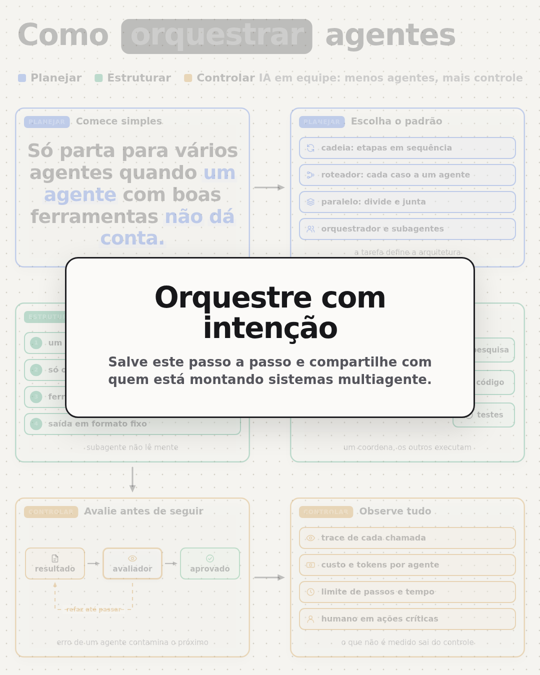
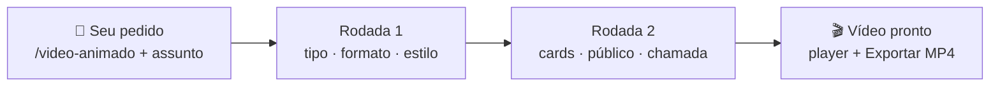
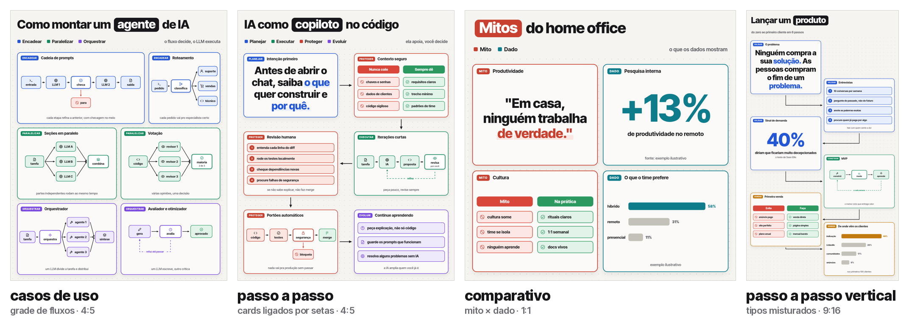
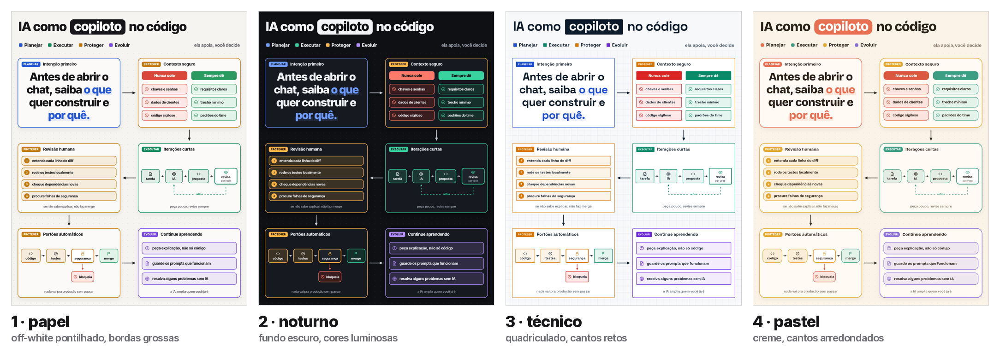
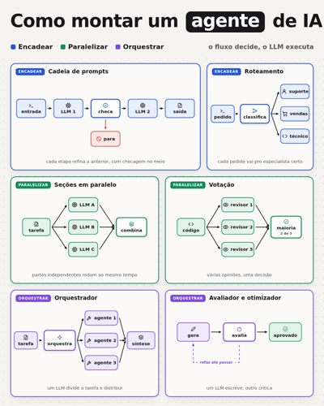
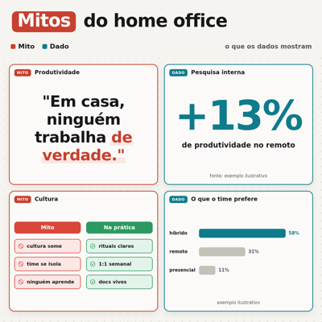
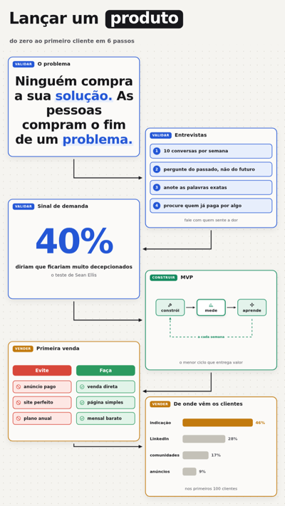
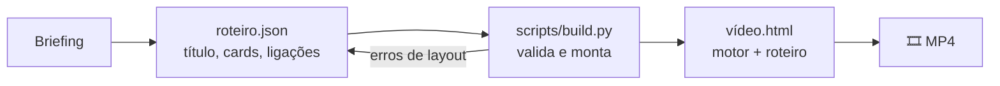

<div align="center">

# 🎬 video-animado

**Uma skill para o Claude que transforma qualquer assunto em um vídeo animado no estilo Jitter, pronto para LinkedIn, Instagram e reels.**

Você diz o tema, responde duas perguntas com cliques e recebe um vídeo com cards, diagramas que se montam, câmera que dá zoom e um botão que exporta o MP4.


<sub>Vídeo gerado com o pedido <code>/video-animado eu quero um post sobre como orquestrar agentes de IA</code></sub>

</div>

---

## ✨ O que ela faz

| 1. Visão geral | 2. Zoom em cada card | 3. Chamada final |
|:---:|:---:|:---:|
|  |  |  |
| Título com destaque, legenda de categorias e todos os cards surgindo. | A câmera entra em cada card e o conteúdo se monta: caixas, setas, listas, números, barras. | A câmera volta para o todo e aparece o cartão com a sua chamada. |

- **7 tipos de post:** passo a passo, comparativo, casos de uso, lista de dicas, números, framework e comparativo de opções.
- **4 estilos visuais:** papel, noturno, técnico e pastel.
- **3 formatos:** feed 4:5, quadrado 1:1 e vertical 9:16.
- **Exportação para MP4** direto no navegador, a 30 fps, sem precisar de editor.

---

## 📦 Instalação

### No claude.ai (web, desktop e app)

1. Baixe o arquivo **`video-animado.zip`** na página de [**Releases**](../../releases/latest) deste repositório.
2. No Claude, abra **Configurações** e procure a área de **Skills** (em *Capacidades/Recursos*).
3. Clique em **Enviar skill** e selecione o `.zip`.
4. Ative a skill e pronto. Para conferir, escreva `/video-animado` numa conversa nova.

> 💡 A execução de código e criação de arquivos precisa estar ligada nas configurações, porque a skill gera o vídeo rodando um script.

### No Claude Code

```bash
git clone https://github.com/SEU-USUARIO/video-animado-skill.git
mkdir -p ~/.claude/skills
cp -r video-animado-skill/video-animado ~/.claude/skills/
```

Use `.claude/skills/` dentro de um projeto se quiser a skill só nele. O script de geração usa apenas Python 3 (sem dependências); a prévia em imagens é opcional e usa Playwright.

---

## 🚀 Como usar

### 1. Peça o vídeo

Escreva `/video-animado` e o assunto:

```
/video-animado eu quero um post sobre como orquestrar agentes de IA
```

### 2. Responda o briefing (só cliques)

O Claude faz duas rodadas curtas de perguntas com botões:



| Rodada | Pergunta | Opções |
|---|---|---|
| 1 | Que tipo de post? | os 4 tipos que mais combinam com o seu assunto |
| 1 | Qual formato? | Feed 4:5 · Quadrado 1:1 · Vertical 9:16 |
| 1 | Qual estilo? | Papel · Noturno · Técnico · Pastel |
| 2 | Quantos cards? | 4 · 6 · 8 · Você decide |
| 2 | Para quem é o post? | públicos sugeridos a partir do tema |
| 2 | O que a chamada final pede? | Salvar e compartilhar · Comentar · Seguir · Conhecer um produto |

Sem tempo? Escreva **"decide você"** junto com o assunto e ela usa os padrões. Já sabe tudo? Cole a [ficha pronta](#-ficha-para-pular-as-perguntas).

### 3. Exporte e publique

- **Exportar MP4:** gera o vídeo no formato escolhido (melhor no Chrome ou Edge).
- **Modo gravação:** esconde os controles e toca do zero, para gravar a tela.
- Narração e trilha você coloca depois, no CapCut ou similar.

### 4. Ajuste conversando

Peça em linguagem normal e o Claude refaz só o que mudou:

> "troca para o estilo noturno" · "passa para 9:16" · "deixa mais lento" · "muda o passo 3 para uma lista" · "escreve a legenda do post"

---

## 🧩 Tipos de post



| tipo | quando usar | como fica |
|---|---|---|
| **Passo a passo** | processos, tutoriais, jornadas | cards ligados por setas; a câmera segue o caminho |
| **Comparativo** | mito × verdade, antes × depois | colunas em vermelho e verde, com número de prova |
| **Casos de uso** | padrões, arquiteturas, "onde X se aplica" | grade de diagramas de fluxo por categoria |
| **Lista de dicas** | "7 dicas", erros comuns, checklists | listas numeradas que entram item a item |
| **Números** | pesquisas, resultados, benchmarks | números que contam e barras que crescem |
| **Framework** | métodos e modelos mentais | frase central e um card por componente |
| **Comparativo de opções** | ferramenta A × B × C | barras por critério, prós e contras, veredito |

## 🎨 Estilos



| estilo | visual | combina com |
|---|---|---|
| **Papel** | off-white pontilhado, bordas grossas, setas pretas | qualquer assunto |
| **Noturno** | fundo escuro, cores luminosas | tecnologia, dados, segurança |
| **Técnico** | quadriculado de engenharia, cantos retos | arquitetura, documentação |
| **Pastel** | creme quente, cantos arredondados | carreira, liderança, comportamento |

## 📐 Formatos

| Feed 4:5 · 1080 × 1350 | Quadrado 1:1 · 1080 × 1080 | Vertical 9:16 · 1080 × 1920 |
|:---:|:---:|:---:|
|  |  |  |
| LinkedIn e Instagram | qualquer rede, carrosséis | stories, reels, shorts, TikTok |

---

## ⚙️ Como funciona por dentro

O Claude não desenha o vídeo do zero: ele escreve um **JSON** com o roteiro, e um motor de animação pronto cuida de câmera, tempos, setas e exportação.



O `build.py` recusa roteiros com cards sobrepostos, ícones inexistentes ou campos faltando, e avisa quando um texto não cabe. Um exemplo de roteiro completo está em [`docs/exemplo-orquestrar-agentes.json`](docs/exemplo-orquestrar-agentes.json).

Quer gerar fora do Claude?

```bash
python3 video-animado/scripts/build.py docs/exemplo-orquestrar-agentes.json meu-video.html
# abra meu-video.html no Chrome e clique em "Exportar MP4"
```

## 📁 Estrutura do repositório

```
video-animado-skill/
├── README.md                  ← esta página
├── docs/                      ← imagens e exemplo deste README
└── video-animado/             ← a skill (é esta pasta que vai no .zip)
    ├── SKILL.md               ← instruções que o Claude segue
    ├── README.md              ← guia rápido de uso
    ├── assets/
    │   ├── template.html      ← motor de animação e exportação
    │   ├── mp4-muxer.js       ← biblioteca de MP4 (MIT)
    │   └── exemplos/          ← imagens de tipos e estilos
    ├── references/            ← estruturas, layouts e roteiros de exemplo
    └── scripts/
        ├── build.py           ← valida o roteiro e gera o HTML
        └── preview.py         ← prévia em imagens (opcional, Playwright)
```

## 📝 Ficha para pular as perguntas

Copie, preencha e envie junto com `/video-animado`. Deixe em branco o que quiser que o Claude decida.

```
Assunto:
Tipo: (passo a passo / comparativo / casos de uso / lista de dicas / números / framework / comparativo de opções)
Formato: (4:5 / 1:1 / 9:16)
Estilo: (papel / noturno / técnico / pastel)
Cards: (4 / 6 / 8)
Público:
Chamada final: (salvar e compartilhar / comentar / seguir / conhecer um produto)
Pontos obrigatórios:
```

---

## 🙏 Créditos

- Exportação MP4 com [mp4-muxer](https://github.com/Vanilagy/mp4-muxer), de Vanilagy (licença MIT, incluída em `video-animado/assets/mp4-muxer.LICENSE`).
- Fontes Inter Tight, Space Grotesk e Bricolage Grotesque, via Google Fonts (SIL Open Font License).
